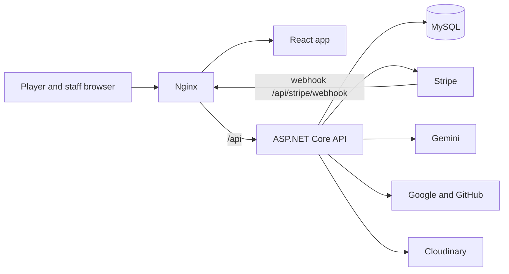
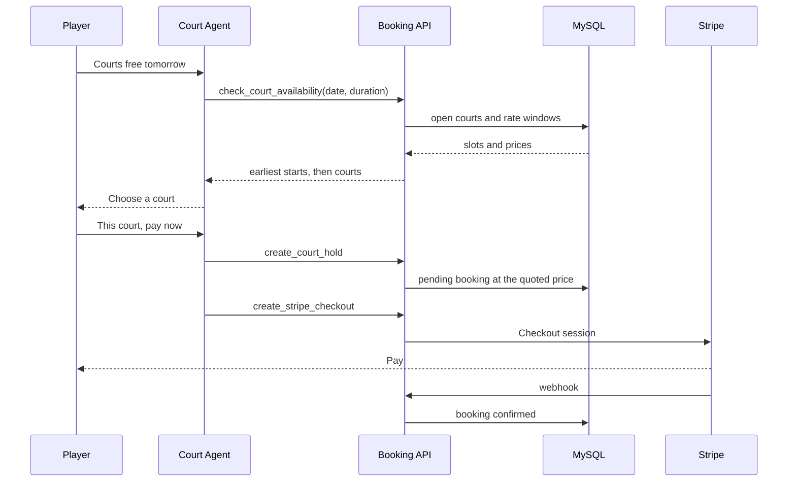

# Shuttle Sync

Shuttle Sync is a badminton booking platform for clubs that want one place to sell courts, run drop-in socials, and take card payments. A player sees which courts are free, holds a weekly time, and pays with Stripe, a promotion code, or reward points. Each venue keeps its own hours, weekday and weekend rate windows, closures, and social sessions.

Staff run the club from a dashboard: courts, prices, promotions, bookings, refunds, and players. Court Agent, the on-site assistant, does not invent a court or a price. It calls the same booking services the HTTP API uses, then asks the player for the next choice.

The live product is [shuttlesync.space](https://shuttlesync.space).

## System shape

The browser is a React single-page app. Every API call goes to `/api` on the same origin, so the session cookies are first-party. Nginx serves the built site and reverse-proxies `/api` to the ASP.NET Core process. That process owns booking rules, pricing, holds, and payments. MySQL is the system of record. Stripe, Gemini, Google, GitHub, and Cloudinary sit outside the process and are called only when that feature is configured.

A court price is not one hourly number. The API slices a booking at each rate-window boundary in the venue timezone, prices each slice, and sums them. A hold stores that quote. If the venue later changes a rate, an unpaid hold is repriced when the player opens payment, and a paid booking either refunds the card difference or asks for the extra.

## Technologies

| Layer | Stack |
| --- | --- |
| Frontend | React 18, TypeScript, Vite, Tailwind CSS, React Router, Redux Toolkit |
| Backend | ASP.NET Core on .NET 10, minimal APIs, Dapper, MySqlConnector |
| Data | MySQL 8 |
| Auth | Email and password, JWT access and refresh tokens in HTTP-only cookies, Google and GitHub OAuth |
| Payments | Stripe Checkout, Stripe webhooks, refunds |
| AI | Gemini function calling for Court Agent, plus Gemini image generation for court artwork |
| Media | Cloudinary for profile photos and court images |
| Production host | Ubuntu VPS, Nginx, Docker Engine, Docker Compose, Certbot |

### Authentication

Sign-in is cookie based, not a token stored in `localStorage`.

#### Demo / Reviewer Admin Credentials

To explore the Staff & Admin Dashboard (`/dashboard`) when reviewing the project, sign in at `/login` with:

| Field | Value |
| --- | --- |
| Email | `admin@gmail.com` |
| Password | `Toyota2025!@#` |
| Role | `admin` (full access to all venues, courts, rates, users, bookings, payments, and AI tools) |

- `POST /api/auth/register` and `POST /api/auth/login` check the email and password, then set an access cookie and a refresh cookie.
- `POST /api/auth/refresh` rotates the refresh token and issues a new access token. The access token is short lived.
- `GET /api/auth/me` returns the current player. `PUT /api/auth/profile` updates the profile.
- Google and GitHub use the authorization-code flow: `GET /api/auth/google/start` and `GET /api/auth/github/start` redirect to the provider, and the matching `/callback` routes create the same cookie session.
- State-changing requests send `X-CSRF-Token`, checked against the CSRF cookie.
- On HTTPS the cookie names use the `__Host-` prefix, `Secure`, and `SameSite=Lax`. Local HTTP can run with `COOKIE_SECURE=false`.
- `POST /api/auth/logout`, `logout-others`, and `logout-all` revoke refresh sessions. A player can list devices with `GET /api/auth/sessions` and revoke one with `DELETE /api/auth/sessions/{id}`.
- Dashboard routes require a signed-in staff or admin role. A staff account only sees venues assigned to them.

## API

All routes are under `/api`. Public venue reads need no session. Holds, checkout, profile, and the dashboard require the access cookie. Paths below use `{slug}` for the venue and `{id}` for a resource id.

### Health

| Method | Path | Purpose |
| --- | --- | --- |
| GET | `/api/health` | Liveness. Returns the service name. |

### Auth

| Method | Path | Purpose |
| --- | --- | --- |
| GET | `/api/auth/csrf` | Issue the CSRF cookie |
| POST | `/api/auth/register` | Create an account |
| POST | `/api/auth/login` | Email and password sign-in |
| POST | `/api/auth/refresh` | Rotate the session |
| GET | `/api/auth/me` | Current user |
| PUT | `/api/auth/profile` | Update name and contact details |
| POST | `/api/auth/avatar` | Upload a profile photo |
| GET | `/api/auth/external-logins` | Linked Google and GitHub accounts |
| GET | `/api/auth/google/start` | Begin Google sign-in |
| GET | `/api/auth/google/callback` | Finish Google sign-in |
| GET | `/api/auth/github/start` | Begin GitHub sign-in |
| GET | `/api/auth/github/callback` | Finish GitHub sign-in |
| GET | `/api/auth/sessions` | Devices with a refresh session |
| DELETE | `/api/auth/sessions/{id}` | Sign one device out |
| POST | `/api/auth/logout` | Sign this browser out |
| POST | `/api/auth/logout-others` | Sign other devices out |
| POST | `/api/auth/logout-all` | Sign every device out |

### Venues, prices, and availability

| Method | Path | Purpose |
| --- | --- | --- |
| GET | `/api/venues` | List active venues |
| GET | `/api/venues/{slug}` | Venue details, hours, and base rate |
| GET | `/api/venues/{slug}/availability` | Courts free or busy on a date |
| GET | `/api/venues/{slug}/court-price` | Price for a start, end, and week count, with one line per rate window |
| GET | `/api/venues/{slug}/rates` | Public weekday and weekend rate windows |
| GET | `/api/venues/{slug}/promotions` | Active promotion codes |
| GET | `/api/venues/{slug}/hours` | Opening hours |
| GET | `/api/venues/{slug}/slots/{id}` | One court session |

### Holds, socials, and checkout

These routes require a signed-in player, except the social catalogue and the Stripe webhook.

| Method | Path | Purpose |
| --- | --- | --- |
| POST | `/api/venues/{slug}/holds` | Hold one or more courts for 1 to 12 weeks |
| POST | `/api/venues/{slug}/holds/pay-now` | Hold a session that starts within 24 hours and open checkout |
| GET | `/api/venues/{slug}/holds/{groupId}` | Load a hold group and any rate change since it was saved |
| POST | `/api/venues/{slug}/holds/{groupId}/courts` | Add courts to a hold |
| POST | `/api/venues/{slug}/holds/{groupId}/checkout` | Pay the selected week with Stripe, points, or both |
| POST | `/api/venues/{slug}/holds/{groupId}/rate-balance` | Pay the extra after a venue rate increase |
| POST | `/api/venues/{slug}/holds/{groupId}/checkout-cancel` | Leave Stripe before paying |
| POST | `/api/venues/{slug}/sessions` | Open one court session |
| POST | `/api/venues/{slug}/sessions/{id}/checkout` | Pay one session |
| GET | `/api/venues/{slug}/socials` | Upcoming public socials |
| GET | `/api/venues/{slug}/socials/{id}` | One social |
| GET | `/api/venues/{slug}/socials/{id}/players` | Who has a place |
| POST | `/api/venues/{slug}/socials/{id}/checkout` | Pay for a place |
| POST | `/api/venues/{slug}/socials/{id}/waitlist` | Join the waitlist when it is full |
| GET | `/api/venues/{slug}/socials/{id}/friends` | Friends added to a social |
| POST | `/api/venues/{slug}/socials/{id}/friends` | Pay for friends |
| POST | `/api/venues/{slug}/socials/checkout` | Pay more than one social |
| GET | `/api/venues/{slug}/socials/registrations/{id}` | One social registration |
| POST | `/api/stripe/webhook` | Stripe payment, expiry, and refund events |

### Player profile

`/api/me` requires a signed-in player.

| Method | Path | Purpose |
| --- | --- | --- |
| GET | `/api/me/bookings` | Booking history, paged |
| GET | `/api/me/bookings/{id}` | One booking and its payment |
| POST | `/api/me/bookings/{id}/cancel` | Cancel, with the late-cancel fee when it applies |
| GET | `/api/me/court-weeks` | Weekly series |
| GET | `/api/me/unpaid-holds` | Holds that still need payment |
| PUT | `/api/me/holds/{groupId}/repeat` | Keep one week ahead |
| POST | `/api/me/holds/{groupId}/move` | Move a week, then pay more or accept a refund |
| GET | `/api/me/holds/{groupId}/week-availability` | Courts free at a new time |
| GET | `/api/me/holds/{groupId}/open-times` | Open times on a date |
| POST | `/api/me/holds/{groupId}/week` | Save a moved or extended week |
| POST | `/api/me/week-copy` | Copy a week onto another date |
| POST | `/api/me/holds/{groupId}/delete-unpaid` | Release an unpaid week |
| GET | `/api/me/holds/{groupId}/delete-series/preview` | Preview cancelling the series |
| POST | `/api/me/holds/{groupId}/delete-series` | Cancel the series |
| GET | `/api/me/payments` | Card payments and refunds |
| GET | `/api/me/rewards` | Points balance and history |
| GET | `/api/me/recommendations` | Offers from the club |
| GET | `/api/me/friend-spots` | Social places bought for friends |

### Dashboard

`/api/dashboard` requires staff or admin. Venue writes, rate windows, and user administration require admin.

| Area | Routes |
| --- | --- |
| Venues | `GET /overview`, `GET /venues`, `POST /venues`, `GET/PUT/DELETE /venues/{id}` |
| Courts | `GET/POST /venues/{id}/courts`, `PUT/DELETE /venues/{id}/courts/{courtId}`, `POST .../ai-image` |
| Sessions | `GET/POST /venues/{id}/sessions`, `PUT/DELETE /venues/{id}/sessions/{sessionId}` |
| Rate windows | `GET/POST /venues/{id}/rates`, `PUT/DELETE /venues/{id}/rates/{rateId}` |
| Closures | `GET/POST /venues/{id}/closures`, `PUT/DELETE /venues/{id}/closures/{closureId}` |
| Socials | `GET/POST /venues/{id}/socials`, `PUT/DELETE /venues/{id}/socials/{socialId}` |
| Incentives | Session and venue reward-point incentives, create, update, delete |
| Promotions | `GET/POST /promotions`, `PUT/DELETE /promotions/{id}` |
| People | `GET /users`, `GET/PUT/DELETE /users/{id}`, assign or remove a venue, revoke a device |
| Money | `GET /bookings`, `PUT /bookings/{id}/status`, `GET /payments`, `GET /refunds`, `GET /webhooks`, `GET /redemptions`, `GET /awards` |
| Other | `GET/POST /recommendations`, `GET /activity`, `POST /activity/page-view`, `POST /images` |

### Court Agent

| Method | Path | Purpose |
| --- | --- | --- |
| POST | `/api/support/chat` | One turn of the assistant. Accepts text or a short voice clip. |

## Court Agent

`POST /api/support/chat` sends the conversation to Gemini with eight function declarations. Gemini may answer in text or request a tool. The API runs that tool on the server, appends the JSON result, and asks the model again until it has a player-facing reply. The model is told that a court, time, price, promotion, or points balance is real only when a tool returned it.

The tools do not call the public HTTP routes over the network. They call the same repositories and payment services those routes call, and they fail with the same business errors. A hold created in chat is the same hold the pay page loads.

| Tool | What the player is doing | Same operation as |
| --- | --- | --- |
| `get_user_booking_context` | See whether they are signed in, their points, and the venue rules | `GET /api/auth/me` plus the venue record |
| `check_court_availability` | Ask which courts are free, then pick a duration and a start time | `GET /api/venues/{slug}/availability` and `GET .../court-price` |
| `suggest_alternative_slots` | Ask for another time when the first one is full | Availability search across the day |
| `list_active_promotions_and_socials` | Ask about a code or a drop-in social | `GET .../promotions` and `GET .../socials` |
| `preview_booking_quote` | Ask what a choice will cost, with a code and points | `GET .../court-price`, then promotion and points math |
| `create_court_hold` | Hold the chosen courts, pay now or pay later | `POST /api/venues/{slug}/holds` |
| `join_public_social` | Take a place in a social | `POST .../socials/{id}/checkout` |
| `create_stripe_checkout` | Pay a hold | `POST .../holds/{groupId}/checkout` |

The court conversation is fixed so the model cannot skip ahead:

1. The player asks for a free court today, tomorrow, or on a chosen date.
2. The agent asks how long they want to play. The page adds duration buttons.
3. For today, `check_court_availability` returns the earliest open start times and the page shows them. For a later date, the player types a time or uses the time picker.
4. The agent calls `check_court_availability` again with that start and duration, then offers only courts the tool returned.
5. After the player picks a court, the agent reads points and promotions, previews the quote, then holds and, when asked, opens Stripe.

Voice uses the same route. The audio clip is transcribed first, then the transcript enters the tool loop. The page can also read the reply aloud.

## Workflow





## Production host

The public site runs on an Ubuntu VPS. These services are installed on that machine:

| Service | Role |
| --- | --- |
| Nginx | HTTPS, the static React build, and the `/api` reverse proxy |
| Certbot | TLS certificate |
| Docker Engine and Docker Compose | The API container, published only on localhost |
| MySQL 8 | The `shuttle_sync` database on the host. The container reaches it through the host gateway |
| UFW | Public SSH, HTTP, and HTTPS. MySQL is not open to the internet |

The browser, the API, and the cookies share one origin, so OAuth callbacks and the Stripe return URL stay on the site.

## Run it locally

You need Node.js 22, the .NET 10 SDK, and MySQL 8.

```bash
git clone https://github.com/thangtruong1808/shuttle-sync-dotnet-react.git
cd shuttle-sync-dotnet-react
cp backend/.env.example backend/.env
cp frontend/.env.example frontend/.env
npm ci --prefix frontend
npm install
```

Create a MySQL database named `shuttle_sync` and apply the schema. The schema SQL is not part of this public tree. In `backend/.env`, set `ASPNETCORE_ENVIRONMENT=Development` so the API loads that file, then set:

| Variable | Purpose |
| --- | --- |
| `ConnectionStrings__Default` | MySQL connection string |
| `JWT_SIGNING_KEY` | At least 32 characters. Use a local key, not a production key |
| `JWT_ISSUER` | For example `shuttle-sync` |
| `JWT_AUDIENCE` | For example `shuttle-sync-web` |
| `ACCESS_TOKEN_MINUTES` | Access-token lifetime |
| `REFRESH_TOKEN_DAYS` | Refresh-token lifetime |
| `COOKIE_SECURE` | `false` for local HTTP |
| `FRONTEND_ORIGIN` | `http://localhost:5173` |

Leave `VITE_API_URL` empty. Vite then proxies `/api` to the API.

```bash
dotnet run --project backend/ShuttleSync.Api.csproj --launch-profile http
npm run dev:frontend
```

The API is `http://localhost:5284`. The site is `http://localhost:5173`.

These stay off until the matching variables are set: Google sign-in, GitHub sign-in, Cloudinary uploads, Stripe test checkout, and Court Agent. The names are in `backend/.env.example`.

## Repository

| Path | Role |
| --- | --- |
| `frontend/` | React application |
| `backend/` | ASP.NET Core API, including Court Agent |
| `backend/Auth/` | Cookies, JWT, CSRF, Google, and GitHub |
| `backend/Booking/` | Venues, holds, checkout, profile, and dashboard |
| `backend/Support/` | Gemini tool loop |
| `deploy/` | Container definition and a sample environment file |
